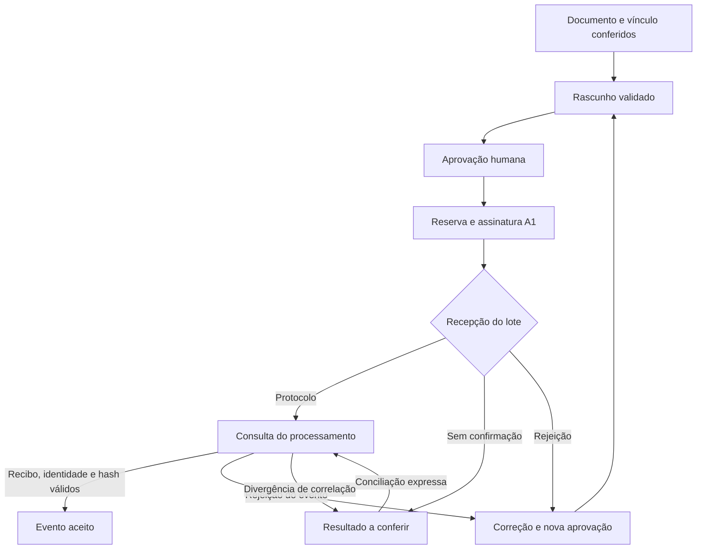

# Mensageria eSocial nativa do NAI

## Escopo e situação operacional

O módulo em `/esocial/messaging` prepara eventos, valida o XML, exige conferência humana, assina com A1 e oferece transmissão e consulta diretamente aos serviços oficiais do eSocial. O fluxo não depende de um pedido, kit ou mensageiro do SOC.

A existência do código, das variáveis em `apphosting.yaml` e do script de infraestrutura **não comprova implantação, provisionamento, autorização por procuração nem homologação**. A configuração operacional precisa ser conferida no ambiente em que o NAI estiver publicado. Os testes deste módulo usam certificados sintéticos e respostas de rede simuladas; não equivalem a uma transmissão aceita pelo governo.

O upload do A1 não aprova eventos, não transmite automaticamente e não habilita produção. A rotina agendada somente consulta lotes previamente transmitidos por uma ação expressa do operador.

**Não há envio de email ao cliente neste fluxo.** A configuração `ASO_CLIENT_EMAIL_SEND_ENABLED=false` também mantém bloqueado o envio de ASOs por email ao cliente na esteira de ASOs. Essa opção não deve ser alterada durante a configuração da mensageria.

### Eventos implementados

| Evento | Dados tratados pelo módulo                   | Origem a conferir                                                  |
| ------ | -------------------------------------------- | ------------------------------------------------------------------ |
| S-2210 | Comunicação de acidente de trabalho          | Dados do acidente, atendimento e responsáveis aplicáveis           |
| S-2220 | Monitoramento da saúde do trabalhador        | ASO e exames efetivamente realizados, profissional e vínculo       |
| S-2240 | Condições ambientais e fatores de risco      | Avaliação técnica, exposição, medidas de controle e responsáveis   |
| S-2221 | Exame toxicológico do motorista profissional | Exame, laboratório, identificação e profissional aplicáveis        |
| S-2230 | Afastamento temporário                       | Início/término, motivo e demais dados exigidos para a situação     |
| S-3000 | Exclusão de um dos eventos acima             | Evento anterior aceito, recibo, trabalhador e tipo correspondentes |

Os schemas e tabelas locais estão fixados em **S-1.3, NT 07/2026, revisão de 20/10/2026, pacote com vigência em 26/10/2026**. Arquivos, origem e checksums constam em [`assets/esocial/s-1.3-20261026/provenance.json`](../assets/esocial/s-1.3-20261026/provenance.json). Novos pacotes oficiais precisam de atualização deliberada e testes antes de substituir essa versão.

O NAI envia campos estruturados em XML. PDFs de ASO e documentos técnicos permanecem no acervo privado: não são anexados ao lote SOAP como se fossem eventos. Cadastro do empregador, estabelecimento e vínculo no RET continuam sendo pré-requisitos externos; este módulo não gera a folha, S-1000 ou eventos admissionais.

## Fluxo operacional



Uma resposta de recepção do lote é diferente do aceite do evento. O NAI só registra `accepted` depois de consultar o resultado, conferir o evento esperado e obter recibo coerente com o XML assinado.

### Estados e transições

| Estado interno | Significado                                                   | Continuidade                                                           |
| -------------- | ------------------------------------------------------------- | ---------------------------------------------------------------------- |
| `draft`        | Conteúdo preparado e validado localmente                      | Completar/corrigir e conferir                                          |
| `approved`     | Operador confirmou identidade e documento da versão atual     | Transmissão expressa, com nova validação de acesso e conexão           |
| `submitting`   | Tentativa reservada e XML assinado preservado                 | Aguardar resposta; uma segunda transmissão da mesma versão é bloqueada |
| `processing`   | Existe protocolo de lote confirmado                           | Consultar até obter o resultado do evento                              |
| `accepted`     | Aceite com recibo e correlação do hash assinado               | Preservar evidências; retificar ou excluir mediante nova operação      |
| `rejected`     | Rejeição explícita do lote/evento                             | Corrigir, gerar nova versão e aprovar novamente                        |
| `uncertain`    | O envio não foi confirmado ou houve divergência de correlação | Conferência e conciliação; não há reenvio automático                   |
| `superseded`   | Uma retificação vinculada foi aceita com recibo               | Consultar o evento substituto e o histórico                            |
| `excluded`     | Uma exclusão vinculada foi aceita com recibo                  | Preservar o original e o recibo de exclusão                            |
| `cancelled`    | Rascunho/operação local cancelado                             | O cancelamento local não exclui evento do governo                      |

`external` permanece reservado no contrato de apresentação; a importação de XML desta implementação recria um rascunho. Ela não importa um suposto aceite externo nem transforma uma assinatura anexada em comprovação governamental.

Qualquer edição invalida a aprovação anterior. Retificação e exclusão devem partir do evento aceito, preservando a relação com seu recibo; não basta digitar um número em um novo rascunho independente.

O `Id` oficial é reservado por transação na coleção privada `eventIds`, com unicidade global dentro de cada ambiente. A reserva acompanha a criação e a edição do rascunho; dois registros, inclusive de clientes diferentes, não podem reutilizar o mesmo `Id` no mesmo ambiente. Esse controle é adicional à prevenção de duplicidade por trabalhador e ocorrência.

Para S-2220 vinculado à esteira, a origem exige ASO recebido e conferido, identificação consistente do colaborador e hash da revisão. Se o PDF for substituído, a retificação exige a revisão atual do documento do mesmo caso. A exclusão preserva a origem e a identidade históricas do evento aceito, sem depender de o PDF antigo continuar sendo o arquivo atual do card. Uma correção posterior de CPF, matrícula ou categoria no cadastro não impede a exclusão do recibo anterior: o CPF, o tipo, o recibo, o empregador e o ambiente do S-3000 continuam vinculados ao evento original, e o cadastro atual do cliente é revalidado.

## Como o comprovante é correlacionado

O transporte confere os namespaces oficiais do SOAP e os identificadores do empregador, transmissor, ambiente, protocolo e evento. O ID interno do retorno precisa coincidir com o ID do invólucro e com o evento reservado pelo NAI. Lotes transmitidos pelo NAI contêm um único evento do grupo 2.

Há dois hashes com funções diferentes:

| Valor                                            | Função                                                        |
| ------------------------------------------------ | ------------------------------------------------------------- |
| SHA-256 dos bytes do arquivo XML, em hexadecimal | Endereçar e conferir a integridade do objeto arquivado        |
| `DigestValue` XMLDSig, em base64                 | Identificar o conteúdo canonicalizado coberto pela assinatura |

O `hash` do recibo oficial é comparado ao `DigestValue` preservado na reserva. O hash dos bytes do arquivo assinado não deve ser usado nessa comparação. Esse controle impede que uma resposta com o mesmo ID, mas referente a outro conteúdo, seja aplicada ao trabalhador do card. A definição do hash do recibo consta da seção 8.6 do [Manual do Desenvolvedor 1.16](https://www.gov.br/esocial/pt-br/documentacao-tecnica/manuais/996775-manualorientacaodesenvolvedoresocialv1-16.pdf).

O código 203 na recepção identifica lote já recebido e não é um recibo do evento. Na consulta, `evtDupl=true` só resulta em evento duplicado aceito quando o retorno inclui recibo e hash correspondentes. Erro de duplicidade sem recibo permanece rejeição, sem inferir aceite.

As ocorrências retornadas são preservadas com seus códigos e descrições. O transporte distingue erro, advertência e histórico de validação; uma ocorrência de histórico, isoladamente, não significa rejeição.

## Certificado A1 e custódia

### Upload e validação local

O upload é reservado a administrador interno e aceita `.pfx` ou `.p12` de até **40 KiB**. A requisição multipart é limitada a 64 KiB. O limite menor do arquivo permite armazenar PFX em base64 e senha dentro do limite do payload do Secret Manager.

O backend verifica a proteção de integridade do PKCS#12, a presença de uma única chave privada, a correspondência entre chave e certificado, a validade temporal, RSA entre 2048 e 8192 bits, uso para assinatura digital e autenticação TLS quando essa finalidade estiver delimitada no certificado. Também exige certificado de usuário final, política declarada ICP-Brasil A1 e titular identificado no `otherName` oficial, com CPF/CNPJ e dígitos verificadores válidos. CNPJ alfanumérico é suportado.

Essas verificações **não atestam cadeia de confiança ICP-Brasil, situação de revogação, procuração ou autorização no eSocial**. Os metadados mantêm `trustChain=NOT_VALIDATED`, `revocation=NOT_CHECKED` e `authorization=NOT_CHECKED`. Uma política escrita no certificado não torna uma autoridade automaticamente confiável.

O perfil de assinatura segue RSA-SHA256, digest SHA-256, transformações Enveloped e C14N 1.0, referência vazia para o documento completo e apenas o certificado final em `X509Certificate`, conforme o [Manual do Desenvolvedor, seção 6.7](https://www.gov.br/esocial/pt-br/documentacao-tecnica/manuais/996775-manualorientacaodesenvolvedoresocialv1-16.pdf). A assinatura produzida é verificada criptograficamente antes de seguir.

### Persistência e renovação

O PFX e a senha ficam somente em uma versão do Google Secret Manager. Firestore recebe metadados públicos do certificado e a referência à versão numérica, nunca o arquivo, a senha ou a chave privada. Não se usa o alias mutável `latest`.

Ao carregar o A1 para uso, o backend abre novamente a versão fixada e confere fingerprint e titular. Uma renovação cria nova versão e aposenta o registro ativo anterior por transação. Isso não libera produção para o novo certificado: as provas e autorizações operacionais permanecem vinculadas ao certificado correspondente.

Aposentar um certificado no NAI impede novos usos pelo fluxo ativo e registra a ação. Essa operação não revoga o certificado na autoridade certificadora e não destrói as versões históricas do cofre.

## Configuração e runbook

### 1. Preparar a infraestrutura e conferir a implantação

#### Preparação da infraestrutura

O script de infraestrutura usa o projeto, região, contas de serviço e endereço do backend definidos em seu próprio arquivo. Confira o plano antes de aplicar em outro ambiente.

```bash
# Exibe o plano; não provisiona nem carrega certificado.
node scripts/setup-esocial-infrastructure.mjs

# Provisiona o cofre vazio, suas permissões e o agendador de consultas.
node scripts/setup-esocial-infrastructure.mjs --apply
```

O modo `--apply` exige permissões de Service Usage, Secret Manager, Cloud Scheduler, consulta/criação de contas de serviço e `iam.serviceAccounts.actAs` sobre a conta utilizada. O script não recebe A1, senha ou dados de evento; não transmite ao eSocial. O resultado precisa confirmar o provisionamento. Uma falha de acesso não deve ser tratada como configuração concluída.

A identidade do agendador é a conta dedicada `nai-esocial-query@{project}.iam.gserviceaccount.com`, usada para invocar a rota interna com OIDC. O script não concede a ela acesso ao Secret Manager, Firestore ou assinatura. As permissões de adicionar e acessar versões do A1 são concedidas, no cofre específico, à conta de execução do App Hosting, `firebase-app-hosting-compute@{project}.iam.gserviceaccount.com`.

Se o job já estiver `PAUSED`, o script preserva explicitamente a pausa e informa `schedulerEnabled=false`. Provisionamento confirmado com job pausado não significa monitoramento em execução; a retomada exige uma ação operacional deliberada.

#### Implantação e verificação do backend

O script prepara recursos de infraestrutura; não publica o código nem comprova que a revisão atual está em execução. A implantação do backend deve ser realizada e verificada separadamente, com as variáveis e a identidade de execução corretas.

As variáveis utilizadas pelo backend são:

| Variável                        | Finalidade                                                                    |
| ------------------------------- | ----------------------------------------------------------------------------- |
| `ESOCIAL_A1_SECRET_NAME`        | Nome autorizado do cofre, no formato `projects/.../secrets/nai-esocial-a1...` |
| `ESOCIAL_SYNC_ENABLED`          | Libera a rotina de consulta de lotes já submetidos                            |
| `ESOCIAL_SYNC_INVOKER_EMAIL`    | Conta dedicada do agendador, autorizada a invocar a rotina                    |
| `ESOCIAL_SYNC_AUDIENCE`         | Audiência OIDC exata da rota interna                                          |
| `ASO_CLIENT_EMAIL_SEND_ENABLED` | Mantida como `false`, conforme instrução de não enviar email a clientes       |

Configuração no arquivo não é verificação do ambiente publicado. O cofre é considerado disponível somente após conferir as permissões de adicionar e acessar versões. O indicador `monitorConfigured` exige as variáveis da rotina habilitadas **e uma execução real concluída há menos de 15 minutos**, registrada em `settings/queryMonitor.lastRunAt`. Somente definir variáveis, criar o job ou publicar o código não torna esse indicador verdadeiro. Esse registro comprova a execução da rotina; não comprova o aceite de todos os lotes pendentes.

### 2. Conferir cliente, colaborador e vínculo da folha

Abra **Mensageria eSocial** e selecione o cliente. O CPF deve identificar um único colaborador desse cliente. Informe a matrícula, ou a categoria quando o vínculo aplicável não tiver matrícula, conforme os dados efetivos do RET. Registre a referência da conferência.

A inscrição do empregador deve corresponder ao cliente e ao S-1000, inclusive quando for utilizada a base do CNPJ. Não substitua matrícula por CPF nem crie vínculo por aproximação do nome. Para eventos novos e retificações, mudanças posteriores no CPF ou no vínculo invalidam a continuidade da versão preparada e exigem nova conferência. O S-3000 mantém a identidade histórica do evento aceito que será excluído, conforme a regra descrita acima.

### 3. Registrar autorização e enviar o A1

Um administrador interno envia o PFX/P12, a senha e a confirmação do titular. O backend compara o CPF/CNPJ informado com o titular extraído do certificado. Mantenha a origem da autorização/procuração aplicável, vigência, outorgado e perfis corretos registrados por cliente.

O cadastro de autorização é uma **declaração conferida pelo operador**, e não uma consulta automática à Receita Federal. O perfil de exame toxicológico é tratado separadamente do perfil de SST. Mudança de outorgado, vencimento ou desativação bloqueia o uso correspondente.

### 4. Preparar e aprovar em produção restrita

Para ASO já conferido, abra **Preparar S-2220** pela esteira. Complete os dados exigidos a partir do documento. Para os demais eventos, utilize o formulário correspondente ou importe um XML para reconstruir o rascunho.

Confira os códigos, datas, matrícula/categoria, informações profissionais e documentos de origem. O responsável deve revisar os dados clínicos ou técnicos de sua competência. A validação automática do XML não substitui essa conferência.

Salve o rascunho, confirme identidade e documento, e aprove a versão. A transmissão ao ambiente restrito é uma ação expressa posterior. Aguarde o protocolo e a consulta que confirma recibo e conteúdo; não considere a recepção do lote como homologação concluída.

### 5. Habilitar produção de forma controlada

A liberação exige, para o **mesmo cliente, A1 e tipo de evento**, um evento aceito no ambiente restrito, seguido de ação explícita de um administrador para habilitar produção. A prova de S-2220 não libera automaticamente S-2210, S-2240 ou outro tipo.

Cada transmissão revalida acesso atual do operador, identidade, versão aprovada, vínculo, autorização e certificado ativo. O agendador não executa essa etapa. O upload/renovação de A1 também não a executa.

### 6. Consultar e arquivar resultados

A consulta manual e o agendador usam o protocolo preservado. O agendador, quando habilitado, é configurado para invocar a rota a cada cinco minutos, processa até dez registros elegíveis por execução e respeita o intervalo de próxima consulta. O serviço usa a estimativa de processamento retornada e aplica recuo progressivo em falhas temporárias. Confira o estado efetivo do job e o registro de execução recente; uma pausa preservada ou falha de invocação impede considerar o monitoramento ativo.

XML preparado, XML assinado e resposta oficial são armazenados sob `esocial-private/v1/{companyId}/{eventIdInterno}/`, com caminho derivado de hash. Não são criadas URLs públicas ou tokens Firebase de download. Downloads passam pela API autorizada por cliente, com conferência de tamanho/hash e registro de acesso.

## Falhas, recuperação e alterações

| Situação                                                              | Tratamento                                                                                                                               |
| --------------------------------------------------------------------- | ---------------------------------------------------------------------------------------------------------------------------------------- |
| Falha antes de validar ou reservar                                    | Nenhuma transmissão deve começar; corrigir cadastro, origem ou autorização                                                               |
| Timeout, conexão interrompida ou resposta não interpretável após POST | `uncertain`; preservar ID e XML assinado; não gerar automaticamente outro envio                                                          |
| Protocolo recebido, atualização agregada interrompida                 | Recuperar o resultado preservado no registro da tentativa e consultar o protocolo                                                        |
| Envio sem protocolo confirmado                                        | A recuperação expressa reutiliza o mesmo ID e os mesmos bytes assinados; não é uma nova preparação silenciosa                            |
| Falha temporária de consulta                                          | Manter o lote pendente e consultar novamente com recuo                                                                                   |
| Divergência de ID, hash, cliente, ambiente ou protocolo               | `uncertain`, protocolo preservado e consulta automática suspensa para conferência                                                        |
| Rejeição de evento                                                    | Corrigir o rascunho e aprovar a nova versão; não reutilizar aprovação antiga                                                             |
| A1 renovado durante pendência                                         | Consultas podem usar A1 ativo do mesmo transmissor; recuperação de envio sem protocolo exige o certificado original ainda válido e ativo |
| Retificação/exclusão aceita                                           | Atualizar o estado do original somente após recibo do evento corretivo                                                                   |

O transporte faz uma única requisição POST por chamada, não segue redirecionamentos e não repete automaticamente o envio. Há prazo total de 30 segundos por requisição, corpo de resposta limitado a 2 MiB e rejeição de conteúdo comprimido inesperado. Os endpoints são constantes do código; uma requisição de usuário não pode fornecer URL, proxy ou raiz de confiança TLS.

Recuperações sem protocolo precisam de conferência operacional. A importação de XML desta entrega não consulta automaticamente identificadores/recibos históricos emitidos por outro mensageiro. O histórico anterior deve ser conciliado antes de preparar eventos que já tenham sido transmitidos por outro sistema.

## Segurança e limites de validação

- Rotas de operação usam autenticação, escopo por cliente e perfis internos autorizados. Clientes externos não acessam o cofre nem a fila privada.
- Aprovação, reserva, identidade e estado usam controle de versão e transações. Não se usa nome do colaborador como chave de identidade.
- XML com DTD, entidades externas, instruções de processamento não permitidas, estrutura ambígua, IDs adicionais ou assinatura em posição indevida é recusado. Há limites de bytes, profundidade e quantidade de nós.
- A assinatura precisa cobrir o documento inteiro com o perfil permitido. Na verificação, os dados usados vêm das referências autenticadas, e o certificado esperado é fixado pelo backend.
- HTTPS usa mTLS com verificação do servidor habilitada e TLS mínimo 1.2. Certificados presentes no PFX não são instalados como autoridades confiáveis do servidor.
- Validade do XML, existência do CPF/CNPJ e consistência com o cadastro local não comprovam situação no RET/RFB, habilitação profissional, correção clínica/técnica ou aceite governamental.
- Senhas, chaves, respostas brutas de provedores e conteúdo clínico não devem ser incluídos em logs de erros. A API devolve mensagens controladas e os artefatos permanecem privados.

## Implementação e verificação

| Responsabilidade                         | Arquivos principais                                                                |
| ---------------------------------------- | ---------------------------------------------------------------------------------- |
| Formulários e códigos                    | `src/lib/esocial-events.ts`, `src/lib/esocial-codes.ts`, `src/components/esocial/` |
| Geração e XSD                            | `src/services/esocial/events.ts`, `assets/esocial/s-1.3-20261026/`                 |
| Inspeção de A1 e XMLDSig                 | `src/services/esocial/certificate.ts`                                              |
| SOAP, mTLS e correlação de retorno       | `src/services/esocial/transport.ts`                                                |
| Cofre e ciclo de certificado             | `src/services/esocial/vault.ts`                                                    |
| Acesso, cadastros e autorizações         | `src/services/esocial/access.ts`, `src/services/esocial/records.ts`                |
| Fila, aprovação, transmissão e correções | `src/services/esocial/messaging.ts`                                                |
| Arquivamento privado                     | `src/services/esocial/artifacts.ts`                                                |
| API e rotina agendada                    | `src/app/api/esocial/`, `src/app/api/internal/esocial-sync/route.ts`               |

As suítes de assinatura, transporte e cofre verificam certificados sintéticos, senha e perfil incorretos, chave divergente, validade, XML malformado/XXE, alteração do conteúdo, assinatura parcial, hashes de recibo divergentes, duplicidade, respostas SOAP oficiais simuladas, tempo limite, redirecionamentos e ausência de reenvio automático. A assinatura também é verificada de forma independente por C14N do libxml2 e pelo mecanismo criptográfico do Node/OpenSSL.

As fixtures SOAP são instâncias sintéticas validadas contra os XSDs oficiais de comunicação. Os pacotes copiados e seus checksums estão em `tests/fixtures/esocial/communication-v1.6/` e `communication-v1.6-alfa/`. Não são comprovantes de uma transmissão real.

```bash
npx vitest run src/services/esocial/certificate.test.ts src/services/esocial/transport.test.ts src/services/esocial/vault.test.ts
npx vitest run src/services/esocial/events.test.ts src/services/esocial/messaging.test.ts
```

## Fontes oficiais e primárias

- [Índice de documentação técnica eSocial](https://www.gov.br/esocial/pt-br/documentacao-tecnica/).
- [Manual de Orientação do Desenvolvedor 1.16](https://www.gov.br/esocial/pt-br/documentacao-tecnica/manuais/996775-manualorientacaodesenvolvedoresocialv1-16.pdf).
- [Pacote de comunicação 1.6: WSDL e XSD](https://www.gov.br/esocial/pt-br/documentacao-tecnica/manuais/pacote-de-comunicacao-esocial-v1-6.zip).
- [Pacote de comunicação 1.6-Alfa: suporte a CNPJ alfanumérico](https://www.gov.br/esocial/pt-br/documentacao-tecnica/manuais/pacote-de-comunicacao-esocial-v1-6-alfa.zip).
- [Ambiente oficial de produção restrita](https://www.gov.br/esocial/pt-br/acesso-ao-sistema/ambiente-de-producao-restrita).
- [Endereços oficiais de transmissão e consulta em produção](https://www.gov.br/esocial/pt-br/noticias/divulgadas-novas-url-para-transmissao-dos-dados-de-producao-do-esocial).
- [ITI: esquema de OIDs ICP-Brasil](https://www.gov.br/iti/pt-br/assuntos/legislacao/adendos/ADE_ICP_04.01___v_6.7__Esquema_de_OID_.pdf).
- [xml-crypto: APIs de assinatura e verificação](https://github.com/node-saml/xml-crypto).
- [node-forge: PKCS#12 e X.509](https://github.com/digitalbazaar/forge).
- [xmldom: parser XML](https://github.com/xmldom/xmldom).

As versões referenciadas foram conferidas para esta implementação em 1º de novembro de 2026. Homologação com o A1 do usuário e implantação são verificações operacionais posteriores; não devem ser inferidas dos testes locais.
